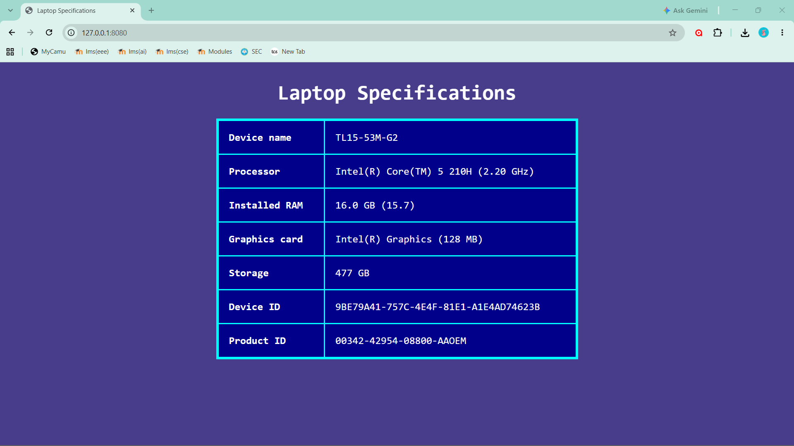

# EX01 Developing a Simple Webserver

# Date: 23/11/2026
# AIM:
To develop a simple webserver to serve html pages and display the configuration details of laptop.

# DESIGN STEPS:
## Step 1:
HTML content creation.

## Step 2:
Design of webserver workflow.

## Step 3:
Implementation using Python code.

## Step 4:
Serving the HTML pages.

## Step 5:
Testing the webserver.

## PROGRAM:
```
from http.server import HTTPServer,BaseHTTPRequestHandler
content='''
<html>
    <head>
        <title>Laptop Specifications</title>
        <style>
            body{
                background-color:darkslateblue;
                font-family: monospace;
            }
            h1
            {
                text-align:center;
                font-size:40px;
                color: white;
            }
            table
            {
                width:700px;
                margin:auto;
                background-color: #1e1e1e;
                border: 5px solid cyan;
                border-collapse:collapse;
                border-radius:12px;
            }
            th,td
            {
                color: white;
                font-size:20px;
                padding:20px;
                text-align: left;
                background-color: darkblue;
                border:3px solid cyan;
            }   
        </style>
    </head>
    <body>
        <table>
            <caption><h1>Laptop Specifications</h1></caption>
            <tr>
                <th>Device name</th>
                <td>TL15-53M-G2</td>
            </tr>

            <tr>
                <th>Processor</th>
                <td>Intel(R) Core(TM) 5 210H (2.20 GHz)</td>
            </tr>

            <tr>
                <th>Installed RAM</th>
                <td>16.0 GB (15.7)</td>
            </tr>

            <tr>
                <th>Graphics card</th>
                <td>Intel(R) Graphics (128 MB)</td>
            </tr>
                        
            <tr>
                <th>Storage</th>
                <td>477 GB</td>
            </tr>
                        
            <tr>
                <th>Device ID</th>
                <td>9BE79A41-757C-4E4F-81E1-A1E4AD74623B</td>
            </tr>

                        
            <tr>
                <th>Product ID</th>
                <td>00342-42954-08800-AAOEM</td>
            </tr>

            
        </table>
    </body>
</html>'''
class MyServer(BaseHTTPRequestHandler):
    def do_GET(self):
        print("Get request recieved...")
        self.send_response(200)
        self.send_header("content-type","text/html")
        self.end_headers()
        self.wfile.write(content.encode())
print("This is my webserver")
server_address=('',8080)
httpd=HTTPServer(server_address,MyServer)
httpd.serve_forever()
```
## OUTPUT:



## RESULT:
The program for implementing simple webserver is executed successfully.
